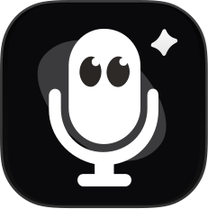

# Voicecore

A macOS voice input and translation app with context-aware text enhancement across apps and URLs. Note Mode and Meeting Mode keep your audio useful beyond plain text.

**English** · [简体中文](./docs/README.zh-CN.md) · [Report Issues][github-issues-link]

[![][github-release-shield]][github-release-link]
[![][macos-version-shield]][macos-version-link]
[![][license-shield]][license-link]
[![][release-date-shield]][release-date-link]

## ✨ Speak, Adapt, Write

**Transcribe — speech to text**

- Live transcription while you speak, with real-time text preview

  <video src="https://github.com/user-attachments/assets/75f08906-3e69-4ab5-9b29-f5c3745cebac" width="500px"></video>

**Translate — text translation**

- AI translation after you finish speaking
- Selected-text translation: highlight text and translate it with a shortcut

  <video src="https://github.com/user-attachments/assets/e69c2737-5d8c-4bd6-9f5b-1123947c7e39" width="500px"></video>

**Rewrite — voice prompts with enhanced results**

- Example: “Help me write a 200-word self-introduction.” Your speech becomes the prompt, and the result is inserted into the editor automatically

[![][back-to-top]](#readme-top)

## Download / Install

- [Latest release](https://github.com/Kivi1998/voicecore/releases/latest)

## License

Hao Jia's original modifications are available under the [MIT License](LICENSE).
Upstream and third-party notices are retained in [NOTICE](NOTICE) and
[THIRD_PARTY_LICENSES](THIRD_PARTY_LICENSES).

[back-to-top]: https://img.shields.io/badge/-BACK_TO_TOP-151515?style=flat-square
[github-issues-link]: https://github.com/Kivi1998/voicecore/issues/new/choose
[github-release-link]: https://github.com/Kivi1998/voicecore/releases/latest
[macos-version-link]: https://github.com/Kivi1998/voicecore/releases/latest
[license-link]: ./LICENSE
[release-date-link]: https://github.com/Kivi1998/voicecore/releases/latest
[github-release-shield]: https://img.shields.io/github/v/release/Kivi1998/voicecore?label=release&labelColor=000000&color=3fb950&style=flat-square&logo=github&logoColor=white
[macos-version-shield]: https://img.shields.io/badge/macOS-15.0%2B-58a6ff?style=flat-square&labelColor=000000&logo=apple&logoColor=white
[license-shield]: https://img.shields.io/badge/License-MIT-58a6ff.svg?style=flat-square&labelColor=000000
[release-date-shield]: https://img.shields.io/github/release-date/Kivi1998/voicecore?style=flat-square&labelColor=000000&color=58a6ff&logo=github&logoColor=white
